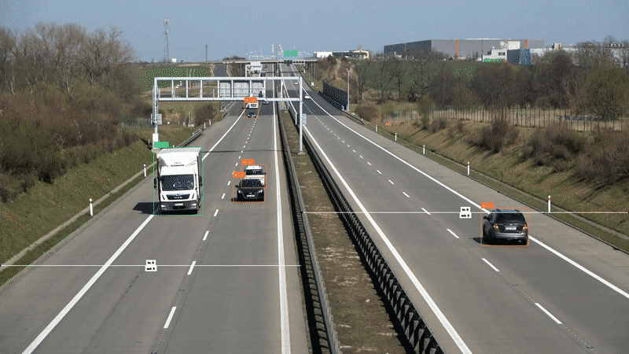

# Freight Gate Vehicle Counter

Counts cars and trucks crossing a gate line in traffic-camera video and logs every crossing to a CSV.
Built with Roboflow (RF-DETR Nano model, a Roboflow Workflow for deduplication) and `supervision` (tracking and line counting).

**Result: 6 of 6 crossings counted on a 12-second test clip, including 1 truck, after four iterations.**



## How it works

| Step | Where | What it does |
|---|---|---|
| 1. Detect | Roboflow Workflow (serverless) | RF-DETR Nano finds cars and trucks in each frame |
| 2. Deduplicate | Same Workflow | When one vehicle gets both a car and a truck box, keeps the higher-confidence one |
| 3. Track | `supervision` ByteTrack | Gives each vehicle an ID that persists across frames |
| 4. Count | `supervision` LineZone | One counting line per side of the road |
| 5. Log | Python `csv` | Writes time, vehicle ID, type and line for each crossing |

Sample output (`crossings.csv`):

```
video_time_s,tracker_id,vehicle_type,line
0.72,1,car,away_from_camera
1.44,2,truck,toward_camera
3.24,7,car,away_from_camera
```

## Run it

```
python3 -m venv .venv && source .venv/bin/activate
pip install inference-sdk "supervision[assets]"
export ROBOFLOW_API_KEY=<your Private API key>
python count_vehicles_workflow.py
```

The script downloads a free sample video. It sends every 3rd frame and stops after about 12 seconds of video to keep API usage low (`FRAME_STRIDE`, `MAX_FRAMES`).

## Results by iteration

| Version | Change | Crossings | Truck counted | Cars driving away |
|---|---|---|---|---|
| 1 | Default: all 4 box corners must cross, one line at 60% height | 4 | No | 1 of 2 |
| 2 | Count when the box's bottom-center crosses | 5 | No | 2 of 2 |
| 3 | Line moved to 75% height | 4 | Yes | 0 of 2 |
| 4 | One line per side of the road (75% toward camera, 60% away) | **6** | **Yes** | **2 of 2** |

Verified by counting crossings manually in the annotated video.

## Issues I hit and how I fixed them

**1. Packages installed but `ModuleNotFoundError`**
- Cause: `pip` installed into a different Python than the one running the script.
- Fix: created a project virtual environment (`venv`).

**2. `401 Unauthorized: This key is not authorized for serverless inference`**
- Cause: I used the publishable key (starts with `rf_`), which can't run Workflows.
- Fix: used the Private API key. The error message doesn't say which key type is needed.

**3. One vehicle labeled as both car and truck**
- Fix: added a deduplication step in a Roboflow Workflow that keeps the higher-confidence label.
- Trade-off: in one test image it kept the wrong label (a car kept as "truck").

**4. Semi truck missed in a still image**
- Cause: it was cut off at the edge of the frame. Fully in frame, the same model detected a semi at 92% confidence.
- Takeaway: place counting lines mid-frame, where vehicles are fully visible.

**5. Truck tracked correctly but never counted (versions 1–3)**
- Debugged frame by frame. The tracker followed the truck as ID #2 the whole time, so detection and tracking were fine.
- Version 1: the tall truck left the frame before all four corners crossed the line.
- Version 2: the clip starts with the truck already on the line, so it was never seen on the "before" side.
- Version 3: lowering the line fixed the truck, but cars driving away were then missed. They enter at the bottom of the frame and are only detected once farther away, by which point they were past the line.
- Fix: one line per direction of traffic.

## What I'd tell a customer

- **Where you put the counting line depends on the camera.** Traffic toward the camera and away from it gets detected at different distances, so a two-way road usually needs one line per direction.
- **Debug a missed count in order:** was it detected, was it tracked, did it cross the line from a visible "before" position?
- **Confidence threshold is a trade-off.** Lower thresholds caught a semi at the frame edge (0.32) but added false boxes. Tune it on footage from your own camera.
- **The biggest accuracy gain would come from fine-tuning on your own gate's footage,** especially labeled semis and partially visible vehicles.

## Limitations

- Tested on one 12-second clip. Longer footage, night, rain and heavy traffic are untested.
- The line positions were set by eye for this camera and would need adjusting for any other.

## Credits

- Test images: camera-16 dataset from Roboflow Universe (CC BY 4.0)
- Sample video: `supervision` assets (`VideoAssets.VEHICLES`)
